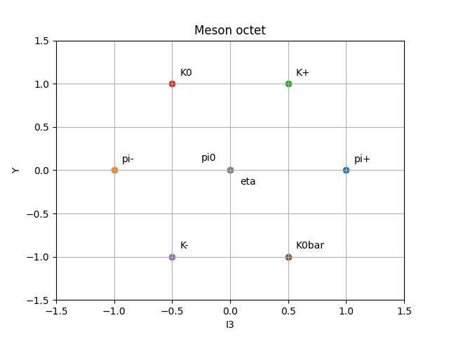

# Meson-Octet



Plots the meson octet (I₃ vs Y) from quark quantum numbers, in Python.

## What it shows

The project shows the meson octet, where the eight members of the spin-0⁻ mesons are plotted on an isospin (I₃) vs hypercharge (Y) graph. A hexagonal pattern emerges in the plot.

- **Charge:** if we connect the dots diagonally, from upper left to lower right, each line has a constant charge (right: Q = +1, middle: Q = 0, left: Q = −1).
- **Strangeness:** if we connect the dots horizontally, each row has a constant strangeness (top: S = +1, middle: S = 0, bottom: S = −1). Since Y = B + S and mesons have baryon number B = 0, Y is equal to the strangeness here.
- **Antiparticles:** a particle and its antiparticle sit at opposite vertices of the hexagon, on either side of the centre (π⁺/π⁻, K⁺/K⁻, K⁰/K̄⁰).
- **Centre:** the particles that are their own antiparticles (π⁰ and η) have Q = 0 and Y = 0, so they sit at the centre of the hexagon.

## How it works

Each quark and antiquark is stored in a dictionary with its charge Q, isospin I₃, strangeness S and baryon number B. A function adds up these numbers for every quark in a particle, and calculates Y = B + S. The results give the coordinates of each point on the plot.

## How to run
```
pip install matplotlib
python Meson-Octet.py
```

## Limitations

- π⁰ and η have identical quantum numbers (I₃ = 0, Y = 0), so they appear at the same point and the plot shows seven dots for eight particles. In the code, `uU` and `dD` are used only as stand-ins for these two.
- The real π⁰ and η are different mixtures of uū, dd̄ and ss̄. This difference does not appear in the quantum numbers, but it shows up in their masses (about 135 MeV for π⁰ and 548 MeV for η).

